

<a href="https://nejib.com"><picture><source media="(prefers-color-scheme: dark)" srcset="assets/banner-dark.svg"><source media="(prefers-color-scheme: light)" srcset="assets/banner-light.svg"></picture></a>

 

<picture><source media="(prefers-color-scheme: dark)" srcset="assets/h-about-dark.svg"><source media="(prefers-color-scheme: light)" srcset="assets/h-about-light.svg"></picture>

Lead Data Engineer and full-stack architect with **15+ years** of experience designing data systems and digital products that run in production. The work spans the whole chain: large-scale **ETL/ELT pipelines** and data collection, **search and ranking engines**, **AI products and APIs**, and **connected hardware**, from the circuit board and firmware to the cloud dashboard.

More than **50 sites and services** are built, hosted and operated on a self-managed infrastructure, with automation at every step: ingestion, enrichment, quality checks, publishing and monitoring.

<table><tr>
<td width="25%" valign="top"><b>Data engineering</b> ETL/ELT at scale, scraping, Elasticsearch, reporting used by large audiences</td>
<td width="25%" valign="top"><b>Applied AI</b> LLM products and APIs, fine-tuning, RAG, automated content pipelines</td>
<td width="25%" valign="top"><b>Full stack</b> PHP, Python and JavaScript platforms, payments, back-offices, SEO</td>
<td width="25%" valign="top"><b>Connected hardware</b> Boards, embedded firmware, MQTT, Home Assistant, cloud telemetry</td>
</tr></table>

 

<picture><source media="(prefers-color-scheme: dark)" srcset="assets/h-key-figures-dark.svg"><source media="(prefers-color-scheme: light)" srcset="assets/h-key-figures-light.svg"></picture>

<picture><source media="(prefers-color-scheme: dark)" srcset="assets/numbers-dark.svg"><source media="(prefers-color-scheme: light)" srcset="assets/numbers-light.svg">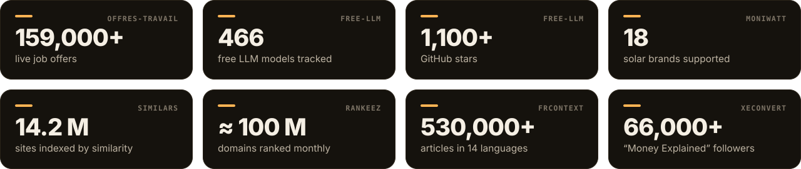</picture>

 

<picture><source media="(prefers-color-scheme: dark)" srcset="assets/h-flagship-products-dark.svg"><source media="(prefers-color-scheme: light)" srcset="assets/h-flagship-products-light.svg"></picture>

<table>
<tr>
<td width="50%" valign="top">
<a href="https://offres-travail.com">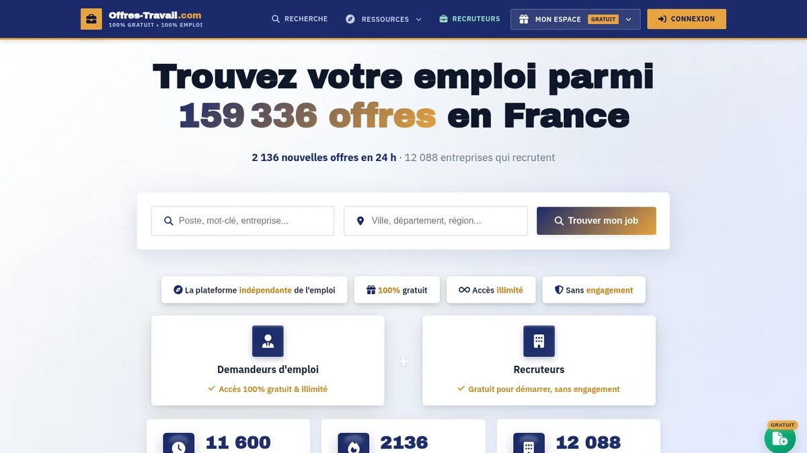</a>

JOB PLATFORM · FRANCE <a href="https://offres-travail.com"><b>Offres-Travail.com</b></a>

Independent job platform with one of the largest job counts in France: nearly <b>160,000 live listings</b>, 2,000+ new ones a day, automatic CV parsing, two-click applications, e-mail alerts and a recruiter area.

<code>Elasticsearch</code> <code>PHP</code> <code>Big Data</code> <code>NLP</code>

</td>
<td width="50%" valign="top">
<a href="https://pylon-monitor.com">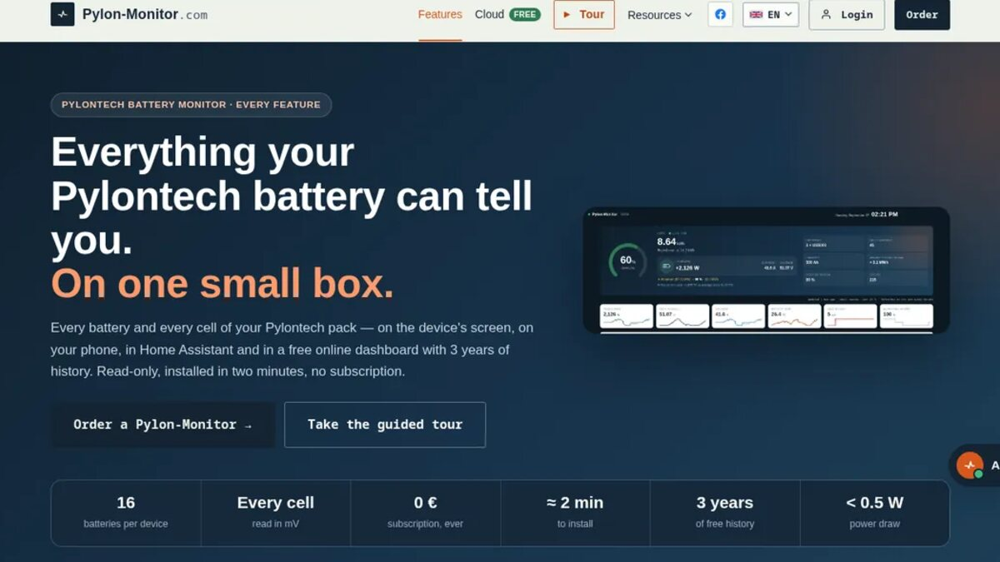</a>

CONNECTED HARDWARE <a href="https://pylon-monitor.com"><b>Pylon-Monitor.com</b></a>

A range of WiFi devices that read Pylontech solar batteries live: charge, health, <b>every cell</b>, temperatures. Firmware, boards, enclosures, cloud, shop and logistics, all designed in-house.

<code>IoT</code> <code>Firmware</code> <code>Home Assistant</code> <code>MQTT</code>

</td>
</tr>
<tr>
<td width="50%" valign="top">
<a href="https://moniwatt.com">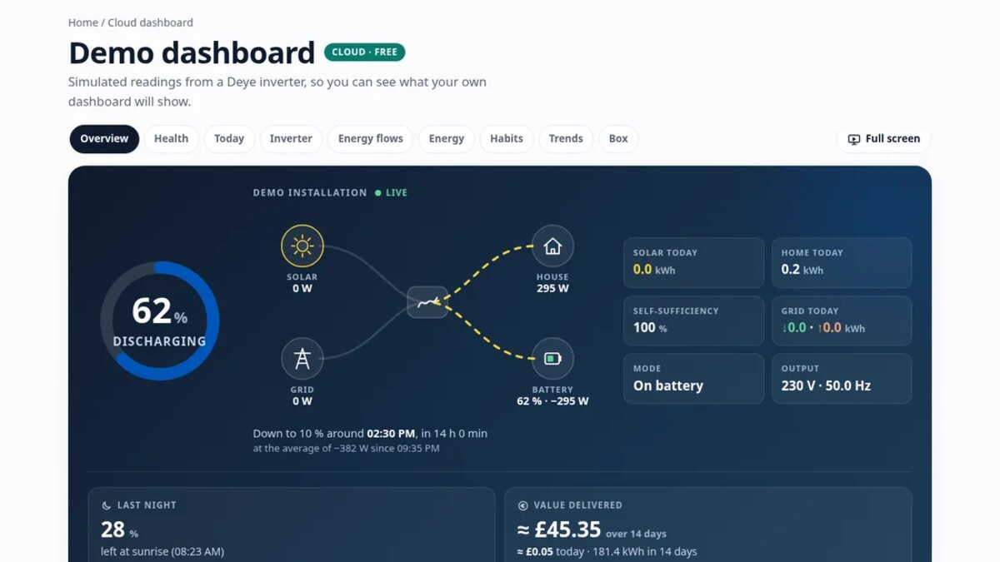</a>

CONNECTED HARDWARE <a href="https://moniwatt.com"><b>MoniWatt.com</b></a>

Pylon-Monitor extended to the whole solar market: one device with a screen in <b>18 editions</b> (batteries, BMS boards, inverters: Deye, JK BMS, Seplos, Growatt, Sunsynk…), each with its own firmware and site in 6 languages.

<code>IoT</code> <code>Firmware</code> <code>Cloud</code> <code>6 languages</code>

</td>
<td width="50%" valign="top">
<a href="https://free-llm.com">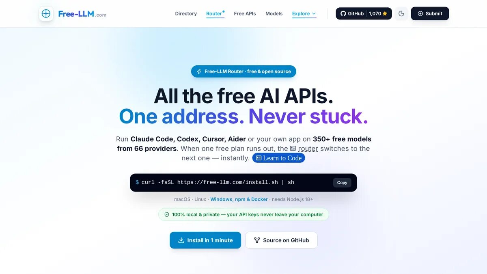</a>

AI · OPEN SOURCE <a href="https://free-llm.com"><b>Free-LLM.com</b></a>

The directory of free LLM APIs: <b>88+ providers and 466 free models</b> with their real limits, plus <a href="https://github.com/nejib1/Free-LLM">Free-LLM Router</a>, which puts every free API behind one OpenAI/Anthropic-compatible endpoint.

<code>LLM</code> <code>API</code> <code>Open source</code> <code>Node.js</code>

</td>
</tr>
</table>

 

<picture><source media="(prefers-color-scheme: dark)" srcset="assets/h-open-source-dark.svg"><source media="(prefers-color-scheme: light)" srcset="assets/h-open-source-light.svg"></picture>

| Repository | What it does | Stack |
|:--|:--|:--|
| [**Free-LLM**](https://github.com/nejib1/Free-LLM)  | Directory of free LLM APIs + Free-LLM Router: every free provider behind one endpoint, with instant failover. | `JavaScript` |
| [**Pylon-Monitor**](https://github.com/nejib1/Pylon-Monitor) | Pylontech battery monitoring docs: Home Assistant, MQTT, Jeedom and Node-RED integration, in 6 languages. | `Docs` |
| [**TraDuck**](https://github.com/nejib1/TraDuck) | Private machine translation on the web and through a simple REST API. | `API` |
| [**HomeAssistant2ESP**](https://github.com/nejib1/HomeAssistant2ESP) | Push Home Assistant data to a microcontroller with an OLED screen. | `C++` |
| [**php-aws-blocker**](https://github.com/nejib1/php-aws-blocker) | Block every AWS IP range with iptables, in one PHP script. | `PHP` |
| [**PHPAntiCrawler**](https://github.com/nejib1/PHPAntiCrawler) | A lightweight way to keep crawlers off a website. | `PHP` |

 

<picture><source media="(prefers-color-scheme: dark)" srcset="assets/h-portfolio-dark.svg"><source media="(prefers-color-scheme: light)" srcset="assets/h-portfolio-light.svg"></picture>

Every product below is designed, built and operated end to end.

<b>AI & language APIs</b> · 7

 

| Product | Description |
|:--|:--|
| [**SummarizeAPI.com**](https://summarizeapi.com) | Text summarisation REST API in 119 languages, with a free monthly tier. |
| [**PDF-Summarize.com**](https://pdf-summarize.com) | PDF summaries up to 300 pages, Q&A with cited page numbers, OCR, 20 languages. |
| [**TrADuck.com**](https://traduck.com) | Private translation in 36 languages on a self-hosted engine, no third-party API. |
| [**TextPerfector.com**](https://textperfector.com) | Grammar, spelling and style correction in 15 languages, with an API. |
| [**CategorizeAPI.com**](https://categorizeapi.com) | Classifies a URL or text into 25 categories with a confidence score, in about a second. |
| [**Tarjma.com**](https://tarjma.com) | Smart Arabic keyboard: type Arabizi, get Arabic script live, then translate. |
| [**Lizarder.com**](https://lizarder.com) | Translation-in-context dictionary: 40 languages, 1,500+ language pairs. |

<b>Web platforms & data</b> · 6

 

| Product | Description |
|:--|:--|
| [**Similars.net**](https://similars.net) | Similar sites and alternatives to any website, over an index of 14.2 M domains. |
| [**Rankeez.com**](https://rankeez.com) | Transparent global traffic rank fusing Tranco, Majestic, CommonCrawl and CrUX signals. |
| [**StatMemory.com**](https://statmemory.com) | Domain intelligence: worth, traffic history, hosting, DNS, WHOIS, security headers. |
| [**XeConvert.com**](https://xeconvert.com) | 290-currency converter in 14 languages, with the “Explained” money section. |
| [**Linux-Alternative.com**](https://linux-alternative.com) | The best Linux alternative to ~400 Windows programs, 555 apps compared. |
| [**Videos-to-MP3.com**](https://videos-to-mp3.com) | Link or file to MP3 in seconds, up to 320 kbps with cover art. |

<b>Hardware, e-commerce & services</b> · 5

 

| Product | Description |
|:--|:--|
| [**Pylon-Check.com**](https://pylon-check.com) | Cloud-first sibling of Pylon-Monitor: three years of history, alerts, balance advice. |
| [**Cables-Solaires.com**](https://cables-solaires.com) | Parallel cables for lithium batteries, assembled in France; 340+ customer reviews across two shops. |
| [**ParallelCables.com**](https://parallelcables.com) | The international, English-language edition of Cables-Solaires. |
| [**NejibTech.com**](https://nejibtech.com) | The reference shop for wireless AZERTY French-Arabic keyboards. |
| [**WebSynchrone.fr**](https://websynchrone.fr) | Turnkey websites and local SEO for craftspeople and small businesses. |

<b>Media & knowledge</b> · 7

 

| Product | Description |
|:--|:--|
| [**L-Actualite.com**](https://l-actualite.com) | Three news sites (France, US, Tunisia) fully automated: topic detection to indexing. |
| [**Esperance-De-Tunis.com**](https://esperance-de-tunis.com/fr/) | Fan site in Arabic and French: live matches updated every 45 seconds. |
| [**FrContext.com**](https://frcontext.com) | 530,000+ articles and answers to everyday questions, in 14 languages. |
| [**Rai2015.com**](https://rai2015.com) | Arabic Q&A encyclopedia: 35,000+ clear answers. |
| [**Ma3loumet.com**](https://ma3loumet.com) | Arabic general-knowledge magazine, with a source for every fact. |
| [**WikiTutoria.com**](https://wikitutoria.com) | Step-by-step guides to French administrative procedures. |
| [**ResterConnecte.com**](https://resterconnecte.com) | A network of daily tutorial sites in four languages. |

<b>Non-profit</b> · 1

 

| Product | Description |
|:--|:--|
| [**Budokan Academy**](https://budokan-academy.com) | Judo club website and sports-management platform: online registrations and a 30-module athlete tracking area. |

Full case studies, screenshots and the complete list on <a href="https://nejib.com"><b>nejib.com</b></a>.

 

<picture><source media="(prefers-color-scheme: dark)" srcset="assets/h-tech-stack-dark.svg"><source media="(prefers-color-scheme: light)" srcset="assets/h-tech-stack-light.svg"></picture>

<table>
<tr><td width="170"><b>Languages</b></td><td>    </td></tr>
<tr><td width="170"><b>Data engineering</b></td><td>      </td></tr>
<tr><td width="170"><b>AI & NLP</b></td><td>      </td></tr>
<tr><td width="170"><b>Databases</b></td><td>    </td></tr>
<tr><td width="170"><b>Cloud & infra</b></td><td>        </td></tr>
<tr><td width="170"><b>IoT & commerce</b></td><td>     </td></tr>
</table>

 

<picture><source media="(prefers-color-scheme: dark)" srcset="assets/h-get-in-touch-dark.svg"><source media="(prefers-color-scheme: light)" srcset="assets/h-get-in-touch-light.svg"></picture>

Portfolio, case studies and contact form on **[nejib.com](https://nejib.com)** · professional profile on **[LinkedIn](https://www.linkedin.com/in/nejib1/)**

 

<a href="https://nejib.com">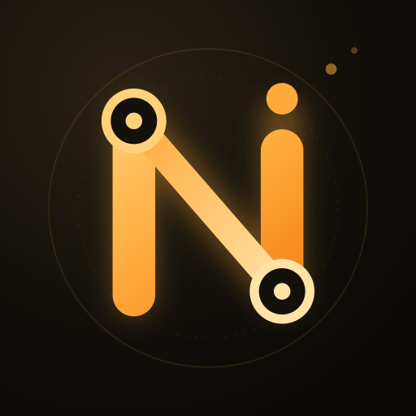</a>

<i>Data is the raw material. Architecture is the craft. Impact is the goal.</i>

